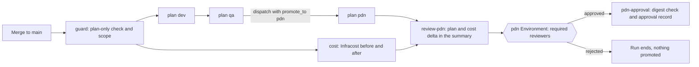

# CD promotion pipeline and production approval

This runbook describes the continuous delivery pipeline of task B12
([roadmap#32](https://github.com/aroma-pacifico/aroma-pacifico-roadmap/issues/32),
box D12). The pipeline promotes one commit of `main` through `dev`, `qa` and
`pdn`, shows the approver the plan and its Infracost cost delta, and leaves a
record of who approved and when. The design it follows is
`docs/automation-and-pipelines.md` (A18) and ADR-003 of
[aroma-pacifico-architecture](https://github.com/aroma-pacifico/aroma-pacifico-architecture).

The code lives in `.github/workflows/cd-promotion.yml` (orchestration, cost,
review and approval), `.github/workflows/cd-plan.yml` (reusable plan of one
environment), `scripts/cd-cost-summary.py` and `scripts/cd-window-check.sh`.

## 1. Plan-only boundary and the decision it forced

The project stops at `terraform plan` (AGENTS.md sections 1 and 4). PC-IAC-028
extends the ban on `apply` and `destroy` to local Floci containers and CI
service runners as well. The acceptance criterion asks for "a mandatory manual
approval ... before applying to production", and the architecture (ASM-214)
describes the production job as applying the reviewed saved plan. The two
cannot both hold, and the pipeline resolves it as follows.

| Option | Verdict | Reason |
|---|---|---|
| Write an apply step that can run only against Floci | Rejected | PC-IAC-028 forbids apply against Floci too, and a step that exists can be re-pointed. |
| Write an apply step disabled by a repository variable | Rejected | One variable change plus a role would turn it into a production apply, which breaks identity separation (AGENTS.md section 8). |
| No apply step; the gated job approves the reviewed plan | Chosen | The approval gate, the evidence and the plan binding are real and exercised on every promotion, and no state-changing path exists. |

In the chosen design the job `pdn-approval` is the position an apply job would
depend on. It runs only after required reviewers approve the Environment `pdn`,
verifies that the plan is byte for byte the one that was reviewed (SHA-256
manifest), re-checks the change window, and writes the approval record. The
job `guard` fails the run if any file under `.github/workflows` or `scripts`
contains a state-changing Terraform command, so the boundary is enforced by the
pipeline and not only by convention. If the faculty advisor ever lifts the
boundary, an apply job would be added with `needs: pdn-approval`, its own
non-cancelling concurrency group and an apply role limited to the `pdn`
Environment, and ASM-214 would be updated first.

## 2. Promotion flow

The diagram is the repository-local view of boxes D12 and D13. The
design-level pipeline diagram is `pipelines/platform-pipeline` in
`aroma-pacifico-diagrams`. This Mermaid source has no SVG or PNG export yet
(see the checklist in section 9).

| Trigger | What runs |
|---|---|
| Push to `main` touching `stacks/`, `environments/`, `.terraform-version`, or the CD files | `guard`, `plan-dev`, `plan-qa` and the `qa` cost estimate. Nothing waits for approval. |
| Manual dispatch, `promote_to = qa` | The same as a push. |
| Manual dispatch, `promote_to = pdn` | Everything above plus `plan-pdn`, the `pdn` cost estimate, `review-pdn` and the gated `pdn-approval`. |

Production is promoted only by manual dispatch on purpose. The design requires a
release note and a notice to the Federation with a lead time (ASM-173) before a
production change, so a production run cannot start by itself on merge. The
dispatch needs `release_note_url` (an HTTPS link to the filled note under
`release-notes/`) or an `incident_reference`. A dispatch from any ref other than
`main` is refused. A newer merge cancels a run still waiting for approval, which
is the "later merge supersedes" rule of A18 section 4.4; re-dispatch after the
merge.

## 3. What the approver sees

Before the gate opens, the job `review-pdn` writes one summary page. The gated
job `pdn-approval` repeats the link to that run page, and the Environment URL
points to it as well.

| Section of the `review-pdn` summary | Content |
|---|---|
| Header table | Promoted commit, the commit used as cost "before", release note link, incident reference, change window status, plan digest. |
| Destroys and replacements | Totals over every stack, stated first in prose, as AGENTS.md section 7 requires. |
| Plan of pdn | One row per stack with the plan result, destroys and replacements; the tail of each plan is in the `plan-pdn` job summary and artifact. |
| Cost estimate of pdn | Infracost previous monthly cost, new monthly cost, delta and percentage per stack and in total. Reads "estimate unavailable" when `INFRACOST_CLI_TOKEN` is missing, and then contains no figure. |

The plan runs against the Floci emulator with the example variable file of the
environment, so it proves that the configuration plans cleanly; it is not a plan
against a live account (ASM-051, PD-019). The cost "before" defaults to the
parent of the promoted commit, which prices the change being promoted. The
`base_ref` input changes it, for example to the last commit that was approved.

## 4. GitHub configuration to apply

Only a repository administrator can do this. Nothing in the repository
configures it.

| Setting | Value |
|---|---|
| Environment `pdn` | Required reviewers: the named humans holding role SR1 or SR2 (ASM-172); the names are the lead's decision and are not written here. Enable "Prevent self-review", so the person who dispatched cannot approve. Deployment branches: `main` only. |
| Environment `qa` | Optional: one reviewer. The plan-only workflow does not reference it, because it plans without credentials; it becomes relevant when an apply role exists. |
| Environment `dev` | No reviewer. Not referenced by the workflow either. |
| Secret `INFRACOST_CLI_TOKEN` | Repository secret, a CLI v2 token of the Infracost organization `aroma-pacifico`. A legacy `ico-` key is rejected by the job. |
| Variable `INFRACOST_ORG` | `aroma-pacifico` (PC-IAC-027). |
| Variable `INFRACOST_METADATA_EGRESS_APPROVED` | `true` (PC-IAC-027). |
| Variable `HARVEST_WEEK_DATES` | Comma separated ISO dates (`YYYY-MM-DD`) of harvest-week days supplied by the Federation (ASM-008). When empty, the check prints a warning and does not block; the review summary shows `calendar-not-configured`. |

Whether the organization plan allows required reviewers on an Environment of a
private repository is open decision PD-020. GitHub documents the feature for
private repositories only on paid plans. If it is unavailable, the gate cannot
be enforced by GitHub and the fallback must still bind a named human to the
reviewed plan; no fallback is coded.

No cloud secret, role or account value exists anywhere in this pipeline. The
plan job uses the fixed Floci test credentials of PC-IAC-028, and the Infracost
job receives no cloud credentials. Untrusted values (the dispatch inputs) reach
shell code only through environment variables.

## 5. Evidence of who approved and when

| Evidence | Where | What it proves |
|---|---|---|
| Review history of the run | The run page, "Review deployments" | Reviewer, decision, comment and time of each approval, kept by GitHub. |
| Environment deployment history | Repository "Environments", `pdn` | The job that waited on the Environment and its time. Read it as the record of an approved plan review, because nothing is deployed. |
| Artifact `approval-record-pdn` (90 days) | The run page, "Artifacts" | JSON with the run URL, commit, plan digest, release note, incident reference, approvers and decisions read from the run approvals API, and a UTC timestamp taken when the job started, seconds after the approval. |
| Job summary of `pdn-approval` | The run page | The same record rendered in the run. |

The approvals API call and the shape of its response have not been exercised
yet. The record falls back to an empty `approvals` list if the call fails, and
the run page remains the authoritative evidence. The release note keeps a copy
of the approval, as ASM-180 asks: the change owner copies the run link and the
record into the release note in a follow-up pull request within one business
day.

## 6. How to notify

"Notify" in the case statement means the notice to the Federation recorded in
the release note, not a chat message (PC-IAC-027 section 7: Slack, Teams and
Discord webhooks are not required). The pipeline carries the notice as data and
does not send it.

| Item | Value |
|---|---|
| Document | The infrastructure release note, copied from `template-infrastructure.md` in `aroma-pacifico-architecture`, committed as `release-notes/<release_id>.md` in the pull request of the release candidate (ASM-180). |
| Recipient | `<recipient named by the Federation, question Q-15, decision PD-171>` |
| Channel | `<channel named by the Federation>`; the design also publishes the note to an SNS topic of the production account whose subscriber the Federation names. That topic is architecture, not coded (ASM-214). |
| Lead time | Default 2 business days before the window of a standard change, Colombia time (ASM-173, pending PD-171). For an incident, at the time of the decision, with the completed note within one business day. |
| In the pipeline | The dispatch requires `release_note_url` or `incident_reference`, and the review summary and approval record repeat it. The coded reading of the note stays architecture (ASM-214). |
| After the run | The outcome, including any rollback, is added to the release note record and reported to the same recipient. |

## 7. How to roll back

Because the project is plan-only, no environment holds a deployment produced by
this pipeline, and there is nothing to undo in a cloud account. The procedure
below is the designed one; its time targets are design targets (ASM-174), not
measurements, and are to be timed by the rehearsal PD-176.

| Step | Action |
|---|---|
| 1. Decide | A `pdn` approver (SR1 or SR2) decides to roll back and records the reason, or the incident reference. |
| 2. Revert | Revert the squash commit on `main` through a pull request (`git revert <commit>` on a branch, never a direct push). A revert is a release candidate like any other. |
| 3. Re-run the plan | Merge, then dispatch the promotion with `promote_to = qa`, then `pdn`. The reviewed plan of the revert should show the inverse of the original change; the approver reads the destroys and replacements first. |
| 4. Notify | Update the release note status to `rolled_back` and send the outcome to the recipient of section 6. |

If the state itself is damaged, recover it from the versioned state bucket of
that environment (ADR-003: one encrypted, versioned bucket per environment, one
key per stack, S3 native locking). Use a plan-role session only to read, and
perform the restore under an incident reference.

| Situation | Recovery |
|---|---|
| State object corrupted or overwritten | List the versions of `<stack>/terraform.tfstate` in `<state-bucket-of-the-environment>`, copy the last good version over the current key so it becomes the newest version, then run a plan to confirm there is no unexpected drift. |
| Stale lock after a cancelled run | Delete only the `<stack>/terraform.tfstate.tflock` object after confirming that no run is active. |
| Change that cannot be reverted | The "cannot be rolled back" table of A18 section 10 applies (sack events, telemetry readings, notices already sent, and so on); the handling there is compensation, not revert. |

## 8. Deduplication after B11 lands

This workflow is deliberately self-contained so that it works whichever B11
pull request merges (#9, #10, #11 or #12). When B11 lands, merge the duplicated
parts into one place.

| Duplicated piece | Here | In B11 |
|---|---|---|
| Floci service container, bucket creation, backend flags, plan loop | `cd-plan.yml` | The plan job of `infrastructure-ci.yml` or `floci-plan.yml`. Extract one reusable plan workflow. |
| Checksum-pinned Infracost CLI install and `scan` invocation | `cost` job in `cd-promotion.yml` | `infracost.yml`. Extract a composite action. |
| Per-stack Infracost project list | Generated at run time per environment | Root `infracost.yml`, which prices `qa` only. |
| Terraform version read and setup | `cd-plan.yml` | `infrastructure-ci.yml`. |

The `actions/checkout` SHA pinned in the B11 branches
(`11d5960a326750d5838078e36cf38b85af677262`, commented v4.2.2) differs from the
commit that the tag `v4.2.2` resolves to
(`11bd71901bbe5b1630ceea73d27597364c9af683`), which is what the CD workflows use.
B11 should re-check its pin.

## 9. Blocked or pending checklist

| Item | Blocked on | Owner |
|---|---|---|
| Configure Environment `pdn` with required reviewers, prevent self-review, `main` only | Repository administrator; PD-020 (plan support) | Human lead |
| Add secret `INFRACOST_CLI_TOKEN`; confirm variables `INFRACOST_ORG` and `INFRACOST_METADATA_EGRESS_APPROVED` | Repository administrator | Human lead |
| Add variable `HARVEST_WEEK_DATES` | The Federation calendar (ASM-008, PD-005) | Human lead |
| Dedupe against B11 (section 8) | B11 landing | B11 and B12 owners |
| Meaningful plans and costs: today the stacks hold only provider, backend and variables, so every plan reads "no changes" and every estimate is zero | Stack wiring B04b, B06b, B07b, B09b | Task owners |
| First real run of the workflows, including the approvals API record, the Infracost output shape and Floci readiness | A human dispatch after merge; none of this has been run | Human lead |
| Decision-log entries for the choices in this document | `ASM-NNN` and `PD-NNN` numbers to be allocated in `aroma-pacifico-architecture` | Human lead |
| SVG and PNG export of the Mermaid flow, if the diagram standard is applied strictly | Diagram owner | Diagram owner |
| Rollback rehearsal in `qa` | PD-176 | SR2 |
| Apply stage | Out of scope while the project is plan-only; needs a lifted boundary and an ADR | Faculty advisor |
