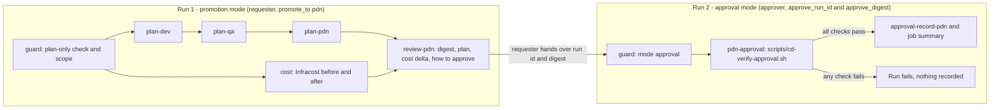

# CD promotion pipeline and production approval

This runbook describes the continuous delivery pipeline of task B12
([roadmap#32](https://github.com/aroma-pacifico/aroma-pacifico-roadmap/issues/32),
box D12). The pipeline promotes one commit of `main` through `dev`, `qa` and
`pdn`, shows the approver the plan and its Infracost cost delta, and leaves a
record of the two named humans who requested and approved it. The approval is a
two-step approval inside the workflow, because GitHub Environment reviewers are
not available to this repository (section 1). The design it follows is
`docs/automation-and-pipelines.md` (A18) and ADR-003 of
[aroma-pacifico-architecture](https://github.com/aroma-pacifico/aroma-pacifico-architecture).

The code lives in `.github/workflows/cd-promotion.yml` (orchestration, cost,
review and approval), `.github/workflows/cd-plan.yml` (reusable plan of one
environment), `scripts/cd-cost-summary.py`, `scripts/cd-window-check.sh` and
`scripts/cd-verify-approval.sh` (checks of the approval run).

## 1. Plan-only boundary and the two decisions it forced

The project stops at `terraform plan` (AGENTS.md sections 1 and 4). PC-IAC-028
extends the ban on `apply` and `destroy` to local Floci containers and CI
service runners as well. The acceptance criterion asks for "a mandatory manual
approval ... before applying to production", and the architecture (ASM-214)
describes the production job as applying the reviewed saved plan. The two
cannot both hold, and the pipeline resolves it as follows. In plain terms: the
approval gate approves a reviewed plan, and nothing is deployed, in any
environment, by this pipeline.

| Option | Verdict | Reason |
|---|---|---|
| Write an apply step that can run only against Floci | Rejected | PC-IAC-028 forbids apply against Floci too, and a step that exists can be re-pointed. |
| Write an apply step disabled by a repository variable | Rejected | One variable change plus a role would turn it into a production apply, which breaks identity separation (AGENTS.md section 8). |
| No apply step; the approval gate approves the reviewed plan | Chosen | The approval, the evidence and the plan binding are real and exercised on every promotion, and no state-changing path exists. |

The job `pdn-approval` is the position an apply job would depend on. It verifies
that the plan is byte for byte the one that was reviewed (SHA-256 manifest),
re-checks the change window, and writes the approval record. The job `guard`
fails the run if any file under `.github/workflows` or `scripts` contains a
state-changing Terraform command, so the boundary is enforced by the pipeline
and not only by convention. If the faculty advisor ever lifts the boundary, an
apply job would be added with `needs: pdn-approval`, its own non-cancelling
concurrency group and an apply role limited to production, and ASM-214 would be
updated first.

The second decision is how to make the approval mandatory on the GitHub Free
plan, where the repository is private by design. GitHub documents, on the page
"Deployments and environments", that required reviewers and wait timers on an
Environment are available only for public repositories on the Free, Pro and Team
plans. On 2026-11-11 the repository had 0 Environments, and the branch
protection API answered 403 with the message "Upgrade to GitHub Pro or make this
repository public". Open decision PD-020 anticipated this and allowed an
alternative gate that still binds a named human to the reviewed plan.

| Option | Verdict | Reason |
|---|---|---|
| Make the repository public | Rejected | The repository is private by design (AGENTS.md section 5); its stack configuration is not for publication. |
| Upgrade to GitHub Enterprise | Rejected | Out of scope for an academic project on the Free plan. |
| Environment `pdn` with required reviewers | Not available | Documented as public-only on Free, and confirmed by the API observations of 2026-11-11 above. |
| Two-step approval inside the workflow | Chosen | A named requester starts run 1, a different named approver from `PDN_APPROVERS` starts run 2 against the digest of run 1, and a script verifies the binding and writes the record. |

The limitation is accepted and stated here so that nobody reads more into the
gate than it gives. On the Free plan anyone with write access to the repository
can change the workflow or the repository variable `PDN_APPROVERS`, and there is
no branch protection either. The gate therefore provides verifiable evidence and
a binding of two named humans to the reviewed plan; it is not a technical
barrier. This is accepted for a plan-only academic project, where nothing can be
deployed, and it closes PD-020 together with the decision-log entries ASM-320 to
ASM-324.

## 2. Promotion flow

The promotion to `pdn` takes two workflow runs. Run 1 is the promotion mode and
ends with the review. Run 2 is the approval mode: it is started by a different
human, who passes the run identifier and the plan digest of run 1.



The diagram is the repository-local view of boxes D12 and D13. The
design-level pipeline diagram is `pipelines/platform-pipeline` in
`aroma-pacifico-diagrams`. This Mermaid source has no SVG or PNG export yet
(see the checklist in section 9).

| Trigger | What runs |
|---|---|
| Push to `main` touching `stacks/`, `environments/`, `.terraform-version`, or the CD files | `guard`, `plan-dev`, `plan-qa` and the `qa` cost estimate. Nothing waits for approval. |
| Manual dispatch, `promote_to = qa` | The same as a push. |
| Manual dispatch, `promote_to = pdn`, `approve_run_id` empty (promotion mode, run 1) | Everything above plus `plan-pdn`, the `pdn` cost estimate and `review-pdn`. The run ends after `review-pdn`. Its summary has a "How to approve" section with the digest and the inputs for run 2, and it stores the artifact `review-context-pdn` (7 days) that run 2 reads. |
| Manual dispatch with `approve_run_id` set (approval mode, run 2) | `guard` runs and reports the mode; `plan-dev`, `plan-qa`, `plan-pdn`, `cost` and `review-pdn` are skipped. Only the job `pdn-approval` ("Production approval", permissions `contents: read` and `actions: read`, no Environment) runs `scripts/cd-verify-approval.sh`, which fails the run unless every check of section 3 passes, and then writes the approval record. Nothing is applied. |

Production is promoted only by manual dispatch on purpose. The design requires a
release note and a notice to the Federation with a lead time (ASM-173) before a
production change, so a production run cannot start by itself on merge. Run 1
needs `release_note_url` (an HTTPS link to the filled note under
`release-notes/`) or an `incident_reference`. A dispatch from any ref other than
`main` is refused, for both runs. Promotion runs share the concurrency group
`cd-promotion-<ref>` with cancellation, so a later push to `main` cancels a
running review, which is the "later merge supersedes" rule of A18 section 4.4.
Approval runs use their own group `cd-promotion-approval-<approve_run_id>`
without cancellation, so an approval run never cancels a promotion run and is
never cancelled by one. Because run 2 must be on the same commit as run 1, a
merge between the two runs moves the commit and invalidates the pending review:
dispatch run 1 again on the new commit.

### 2.1 How to promote to production

The commands use the GitHub CLI; the same inputs can be entered in the Actions
page, "Run workflow".

1. The requester prepares the release note under `release-notes/` (or has an
   incident reference) and dispatches run 1 from `main`:

   ```bash
   gh workflow run "CD promotion" -R aroma-pacifico/aroma-pacifico-infrastructure --ref main -f promote_to=pdn -f release_note_url=<https-link-to-the-release-note>
   ```

   For an incident, pass `-f incident_reference=<reference>` instead of the link.
   The release note and the incident reference are given only here: run 2
   ignores any value typed for them and reads the ones stored by run 1.
2. The requester reads the review summary of run 1 (section 3): destroys and
   replacements first, then the plan table and the cost delta, and copies the
   run identifier and the plan digest from its "How to approve" section.
3. A different person listed in `PDN_APPROVERS` reads the same summary and
   dispatches run 2 from `main`, while `main` is still at the reviewed commit,
   filling only the two inputs:

   ```bash
   gh workflow run "CD promotion" -R aroma-pacifico/aroma-pacifico-infrastructure --ref main -f approve_run_id=<run-id-of-run-1> -f approve_digest=<plan-digest>
   ```

4. Open run 2. If the job "Production approval" is green, the record is the
   artifact `approval-record-pdn` and the job summary (section 5). If it is red,
   the log names the failed check; fix the cause or start again from step 1.

## 3. What the approver sees and what the approval run checks

Run 1 ends with the job `review-pdn`, which writes one summary page. That page
is what the approver reads before dispatching run 2.

| Section of the `review-pdn` summary | Content |
|---|---|
| How to approve | A table with the two inputs of run 2, `approve_run_id` (the identifier of this run) and `approve_digest`, and the statement that the approval is a second run by a person other than the requester. |
| Header table | Requester, promoted commit, the commit used as cost "before", release note link, incident reference, change window status, plan digest. |
| Destroys and replacements | Totals over every stack, stated first in prose, as AGENTS.md section 7 requires. |
| Plan of pdn | One row per stack with the plan result, destroys and replacements; the tail of each plan is in the `plan-pdn` job summary and artifact. |
| Cost estimate of pdn | Infracost previous monthly cost, new monthly cost, delta and percentage per stack and in total. Reads "estimate unavailable" when `INFRACOST_CLI_TOKEN` is missing, and then contains no figure. |

The plan runs against the Floci emulator with the example variable file of the
environment, so it proves that the configuration plans cleanly; it is not a plan
against a live account (ASM-051, PD-019). The cost "before" defaults to the
parent of the promoted commit, which prices the change being promoted. The
`base_ref` input changes it, for example to the last commit that was approved.

The job `pdn-approval` of run 2 runs `scripts/cd-verify-approval.sh`, which
stops at the first failing check. The checks run in this order.

| Check | Rule |
|---|---|
| Inputs are well formed | `approve_run_id` is numeric and is not the identifier of the approval run itself; `approve_digest` is 64 hexadecimal characters (upper or lower case). |
| Approver is authorized | The person who triggered run 2 (`github.triggering_actor`) is listed in the repository variable `PDN_APPROVERS`, compared without regard to case. An empty or unset variable fails with its own message, so nobody can approve until it is set. |
| Run 1 is the right run | Run `approve_run_id` is the workflow `CD promotion` of this repository, started by `workflow_dispatch`, completed with `success`, on `main`, and on the same commit as run 2. |
| Artifacts of run 1 | The artifacts `plan-pdn` and `review-context-pdn` can be downloaded. Both expire after 7 days, and the error says so. |
| Digest binds the plan | The plan files pass `sha256sum --check` against `SHA256SUMS`, and the digest recomputed from that manifest equals `approve_digest`. |
| Review context | The file `review-context.json` of `review-context-pdn` (keys `requester`, `commit`, `release_note_url`, `incident_reference`, `plan_digest`, `promote_to`) names a requester, has `promote_to = pdn`, and its commit and digest equal those of run 2 and the recomputed digest. |
| Four eyes | The approver differs from the requester in the context, from the actor of run 1 and from the person who triggered run 1. This is stricter than ASM-172 asks. |
| Change window | Without an incident reference, the stored release note must be an `https://` link. The check of `scripts/cd-window-check.sh` then passes again at approval time, with the incident reference stored by run 1 as the override. |

The release note, the incident reference and therefore the window override all
come from run 1. Run 2 ignores `release_note_url` and `incident_reference` typed
on it, so an approver cannot add an incident reference of their own. When every
check passes, the job writes the artifact `approval-record-pdn` and a job
summary (section 5). It applies nothing.

No explicit maximum age for run 1 is coded, and deciding one is open (section 9).
In practice the age is bounded by the 7 days that the artifacts of run 1 are
kept, after which the approval fails on the artifact check.

## 4. GitHub configuration to apply

Only a repository administrator can do this. Nothing in the repository
configures it. No Environment is needed: the workflow does not use
`environment:`, so there is nothing to set up under Settings, Environments.

| Setting | Value |
|---|---|
| Variable `PDN_APPROVERS` | Comma separated GitHub logins of the humans in role SR1 or SR2 (ASM-172) who may approve a production promotion; the names are the lead's decision and are not written here. |
| Secret `INFRACOST_CLI_TOKEN` | Repository secret, a CLI v2 token of the Infracost organization `aroma-pacifico`. A legacy `ico-` key is rejected by the job. |
| Variable `INFRACOST_ORG` | `aroma-pacifico` (PC-IAC-027). |
| Variable `INFRACOST_METADATA_EGRESS_APPROVED` | `true` (PC-IAC-027). |
| Variable `HARVEST_WEEK_DATES` | Comma separated ISO dates (`YYYY-MM-DD`) of harvest-week days. It stays empty until the Federation supplies the calendar (ASM-008). An empty value prints a warning and does not block; the review summary shows `calendar-not-configured`. |

Set the approvers with the command below, using the real logins:

```bash
gh variable set PDN_APPROVERS --body "<login1>,<login2>" -R aroma-pacifico/aroma-pacifico-infrastructure
```

No cloud secret, role or account value exists anywhere in this pipeline. The
plan job uses the fixed Floci test credentials of PC-IAC-028, and the Infracost
job receives no cloud credentials. Untrusted values (the dispatch inputs) reach
shell code only through environment variables.

## 5. Evidence of who approved and when

| Evidence | Where | What it proves |
|---|---|---|
| Run 1 page | Actions, the run named by `approve_run_id` | The requester (who triggered the run), the time, the plan and cost review, and the digest. |
| Run 2 page | Actions, the approval run | The approver (who triggered the run), the time, and that every check of section 3 passed. |
| Artifact `approval-record-pdn` (90 days) | The page of run 2, "Artifacts" | The file `approval-record-pdn.json` with the keys `result`, `nothing_applied`, `requester`, `approver`, `review_run`, `approval_run`, `commit`, `plan_digest`, `release_note`, `incident_reference`, `window_status` and `approval_checked_at_utc`. |
| Job summary of `pdn-approval` | The page of run 2 | The same record as a table, with the time the checks passed (UTC). |

Read all four as the record of an approved plan review, because nothing is
deployed. They show two named humans bound to one digest of one commit; they are
verifiable evidence and not a technical barrier (section 1). The release note
keeps a copy of the approval, as ASM-180 asks: the change owner copies the run
links and the record into the release note in a follow-up pull request within
one business day.

## 6. How to notify

"Notify" in the case statement means the notice to the Federation recorded in
the release note, not a chat message (PC-IAC-027 section 7: Slack, Teams and
Discord webhooks are not required). The pipeline carries the notice as data and
does not send it.

| Item | Value |
|---|---|
| Document | The infrastructure release note, copied from `template-infrastructure.md` in `aroma-pacifico-architecture`, committed as `release-notes/<release_id>.md` in the pull request of the release candidate (ASM-180). |
| Recipient | `<recipient named by the Federation, question Q-15, decision PD-171>` |
| Channel | `<channel named by the Federation>`; the design also publishes the note to an SNS topic of the production account whose subscriber the Federation names. That topic is architecture, not coded (ASM-214). |
| Lead time | Default 2 business days before the window of a standard change, Colombia time (ASM-173, pending PD-171). For an incident, at the time of the decision, with the completed note within one business day. |
| In the pipeline | The dispatch requires `release_note_url` or `incident_reference`, and the review summary and approval record repeat it. The coded reading of the note stays architecture (ASM-214). |
| After the run | The outcome, including any rollback, is added to the release note record and reported to the same recipient. |

## 7. How to roll back

Because the project is plan-only, no environment holds a deployment produced by
this pipeline, and there is nothing to undo in a cloud account. The procedure
below is the designed one; its time targets are design targets (ASM-174), not
measurements, and are to be timed by the rehearsal PD-176.

| Step | Action |
|---|---|
| 1. Decide | A `pdn` approver (SR1 or SR2) decides to roll back and records the reason, or the incident reference. |
| 2. Revert | Revert the squash commit on `main` through a pull request (`git revert <commit>` on a branch, never a direct push). A revert is a release candidate like any other. |
| 3. Re-run the plan | Merge, then dispatch the promotion with `promote_to = qa`, then `pdn` (the two runs of section 2.1). The reviewed plan of the revert should show the inverse of the original change; the approver reads the destroys and replacements first. |
| 4. Notify | Update the release note status to `rolled_back` and send the outcome to the recipient of section 6. |

If the state itself is damaged, recover it from the versioned state bucket of
that environment (ADR-003: one encrypted, versioned bucket per environment, one
key per stack, S3 native locking). Use a plan-role session only to read, and
perform the restore under an incident reference.

| Situation | Recovery |
|---|---|
| State object corrupted or overwritten | List the versions of `<stack>/terraform.tfstate` in `<state-bucket-of-the-environment>`, copy the last good version over the current key so it becomes the newest version, then run a plan to confirm there is no unexpected drift. |
| Stale lock after a cancelled run | Delete only the `<stack>/terraform.tfstate.tflock` object after confirming that no run is active. |
| Change that cannot be reverted | The "cannot be rolled back" table of A18 section 10 applies (sack events, telemetry readings, notices already sent, and so on); the handling there is compensation, not revert. |

## 8. Deduplication against B11

This workflow is deliberately self-contained and depends on no B11 workflow.
The whole B11 set is now on `main`: pull requests #9, #10 and #11
(`infrastructure-ci.yml`, `infracost.yml`, `floci-plan.yml`) and #12, which
completed the same ground and is merged. The duplicated parts can now be merged
into one place in a follow-up change.

| Duplicated piece | Here | In B11 |
|---|---|---|
| Floci service container, bucket creation, backend flags, plan loop | `cd-plan.yml` | `floci-plan.yml`, completed by PR #12. Extract one reusable plan workflow. |
| Checksum-pinned Infracost CLI install and `scan` invocation | `cost` job in `cd-promotion.yml` | `infracost.yml`. Extract a composite action. |
| Per-stack Infracost project list | Generated at run time per environment | Root `infracost.yml`, which prices `qa` only. |
| Terraform version read and setup | `cd-plan.yml` | `infrastructure-ci.yml`. |

The `actions/checkout` SHA pinned in the B11 workflows
(`11d5960a326750d5838078e36cf38b85af677262`, commented v4.2.2) differs from the
commit that the tag `v4.2.2` resolves to
(`11bd71901bbe5b1630ceea73d27597364c9af683`), which is what the CD workflows use.
B11 should re-check its pin.

## 9. Blocked or pending checklist

| Item | Blocked on | Owner |
|---|---|---|
| Set variable `PDN_APPROVERS` with the logins of the SR1 and SR2 approvers (section 4) | Repository administrator; the lead names the approvers | Human lead |
| Add secret `INFRACOST_CLI_TOKEN`; confirm variables `INFRACOST_ORG` and `INFRACOST_METADATA_EGRESS_APPROVED` | Repository administrator | Human lead |
| Add variable `HARVEST_WEEK_DATES` (empty until then: warning, no block) | The Federation calendar (ASM-008, PD-005) | Human lead |
| Dedupe against B11 (section 8) | A follow-up change; the B11 set, including #12, is merged | B11 and B12 owners |
| Meaningful costs: the stacks are wired (B04b, B06b, B07b and B09b are merged), so the plans list resources, but an estimate needs the Infracost secret and variables above | Repository administrator | Human lead |
| First real dispatch of both runs, including the approval checks, the manifest digest, the Infracost output shape and Floci readiness | A human dispatch after merge; the workflows have never run on GitHub | Human lead |
| Explicit maximum age of run 1 for the approval | Not coded; today only the 7-day artifact expiry limits it; to be decided | Human lead |
| Decision-log entries for the choices in this document | ASM-320 to ASM-324 and the closing of PD-020 in `aroma-pacifico-architecture` | Human lead |
| SVG and PNG export of the Mermaid flow, if the diagram standard is applied strictly | Diagram owner | Diagram owner |
| Rollback rehearsal in `qa` | PD-176 | SR2 |
| Apply stage | Out of scope while the project is plan-only; needs a lifted boundary and an ADR | Faculty advisor |
